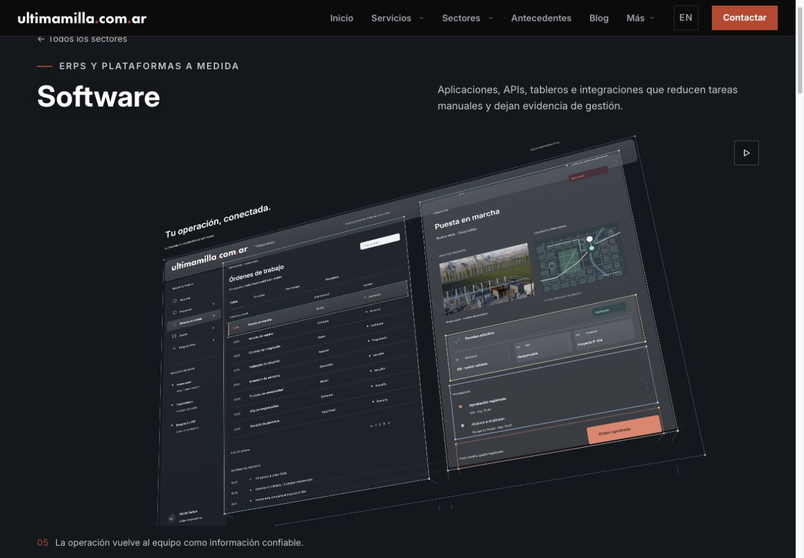
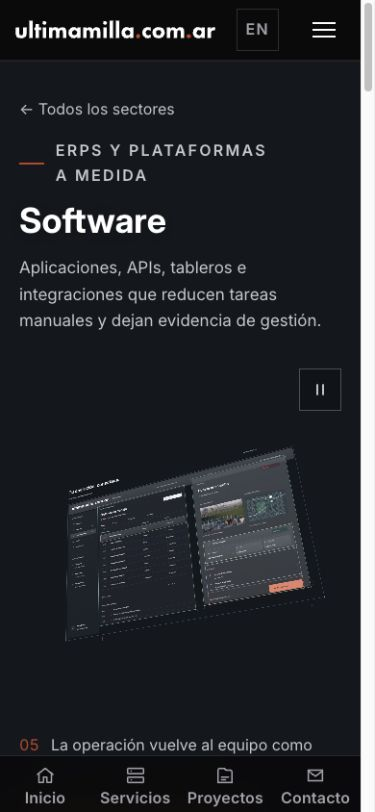
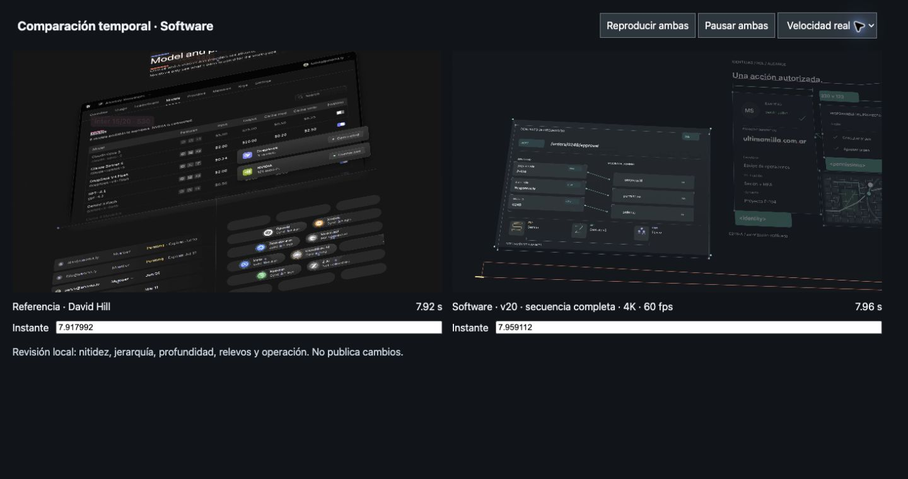

# Software v20 · controles, material y continuidad

## Comparación de partida

Se revisan el original de [David Hill](https://x.com/iamdavidhill/status/2107616166713655476), sus fotogramas nativos y la v19 integrada. A igual tamaño, la referencia distingue más claramente controles, contenido y anotaciones; los cambios de encuadre conservan una interfaz reconocible. La v19 tiene superficies demasiado uniformes, transiciones con poca presencia y símbolos de integración poco diferenciados.

Esta iteración se concentra en el render de Software. Conserva la isometría explicativa debajo y la selección mediante bandera local. No modifica la campaña protegida, las fuentes ni el registro de producción.

## Implementación

- Vidrio de menor opacidad, color menos azulado y una variación sutil de luminancia dentro de cada superficie. Texto secundario más claro; contenido y estructura mantienen materiales separados.
- Controles de permisos con pista y pulgar animado. El estado autorizado y su movimiento responden al mismo instante de validación.
- Símbolos específicos de registros, intercambio y equipo para ERP, API y CRM. Campos con esquinas registradas en su propia profundidad y etiquetas de tipo.
- Cotas con portador turquesa, cifras blancas y ancho ajustado. Los portadores aparecen cuando comienza su anotación, sin rectángulos vacíos previos.
- Estado pendiente antes de confirmar la transacción. Una validación recorre todos los fotogramas y rechaza la superposición de las palabras de estado.
- Apertura más cercana. El listado saliente se desplaza para liberar la silueta de identidad; el sistema completo regresa antes, sin dejar un listado aislado en el vacío.
- Se conservan las correcciones de la leyenda de integridad y de la continuidad de cámara de v19. Se dejan de dibujar planos transparentes totalmente inactivos; no se acorta el movimiento ni se reduce resolución.

## Revisión e iteraciones

Primera prueba nativa: `38092468781`. Reveló cifras con contraste insuficiente y acentos de campos que no seguían la profundidad del campo. Corregidos en `73851a36`; segunda prueba: `38092687457`.

La revisión de 3 s y 17,8 s reveló el borde del listado cruzando identidad y un regreso demasiado vacío. Se corrigieron trayectoria y tiempos de presencia. Prueba de relevos: `38092810829`, autor `7f0fc7dd`.

Prueba de movimiento nativo y retirada de vidrio inactivo: `38092917003`. Autor final de la secuencia: `eb81cbf4`, con exclusión temporal de los estados pendiente/confirmado.

Render completo: `38092976222`. Blender se ejecuta en workers remotos. El Mac sólo recibe medios y ejecuta validaciones y la preview.

## Validación previa a la entrega

- 75 pruebas relevantes correctas.
- Typecheck correcto; lint sin errores, con diez advertencias preexistentes.
- Auditoría con avances reales de fuente: 172 combinaciones texto/composición dentro del encuadre en 1.200 posiciones.
- Importador y ensamblador verifican fuente, resolución, cadencia, fotogramas, activos originales y hashes.

Revisión intermedia de los primeros diez segundos concatenados, en Chrome y a tamaño comparable con el original: reproducción activa en 3840 × 2160; el relevo de 3,35 s despeja el listado saliente y los permisos de 4,5 s distinguen pistas, estado y conexiones. El original tiene más variedad de contenido de producto; esta revisión no permite declarar equivalencia artística. Los cuarenta fragmentos terminaron correctamente y se ensamblaron las dos composiciones completas. Se revisaron además el registro a 14,6/15,55 s y el regreso a 17,8/18,2/19,5 s. Se conserva el contenido completo al volver al conjunto. Las pruebas geométricas no sustituyen el control visual ni certifican equivalencia artística con la referencia.

## Entrega integrada y evidencia

- Run `38092976222`: éxito; 40 fragmentos, 1.200 fotogramas por composición, 20 s a 60 fps nativos.
- Seis activos nuevos: 57.295.707 bytes en total. Vídeo ancho: 36.993.036 bytes; cuadrado: 19.307.092 bytes. Se conserva el encode de los workers, sin interpolación ni reducción de resolución.
- Ensamblado con decodificación completa, color, dimensiones, cadencia, autor y hashes correctos. Importación aislada mediante `UM_SOFTWARE_REVIEW=v20`.
- Build final correcto en 19,99 s. `/software` y servicio 104 responden 200 y seleccionan v20; ambos MP4 responden Range 206.
- Chrome: autoplay nativo, cambio de leyendas, pausa/reanudación en escritorio y móvil, y retorno del reloj de 19,38 s al ciclo siguiente comprobados. Composición 3840 × 2160 en escritorio y 2160 × 2160 en móvil. Sin errores de consola durante esta revisión.
- Inspección visual en 1440 × 1000, 834 × 1112 y 390 × 844; comprobaciones adicionales de ancho en 1280 y 360. Sin desborde horizontal. Los controles y la leyenda se mantienen fuera de la imagen; en pantallas cortas hace falta desplazarse para ver la sección completa.

## Dictamen comparativo

Hay mejoras verificables frente a v19: el relevo hacia identidad despeja la lectura, los controles tienen estados propios, los tipos y cotas están registrados en profundidad, el registro cambia sin duplicar palabras y el retorno recupera contexto. La composición incluye marca, mapa e imagen propia.

La referencia de Hill conserva mayor variedad de contenido y más contraste local entre mecanismos. La vista general de nuestro producto sigue siendo densa y sus microtextos pequeños en móvil; los acercamientos y la leyenda exterior explican la operación. No se certifica una calidad indistinguible ni se declara GO a producción. La revisión por capturas, muestreos temporales, continuidad matemática y estados del reproductor no equivale a una evaluación perceptual continua de todos los fotogramas en dispositivos físicos.

Esta entrega trabaja el render de Software. No modifica ni vuelve a certificar las isometrías frente a Ryan o los sistemas de Solvaix. PR #266 continúa como draft.
