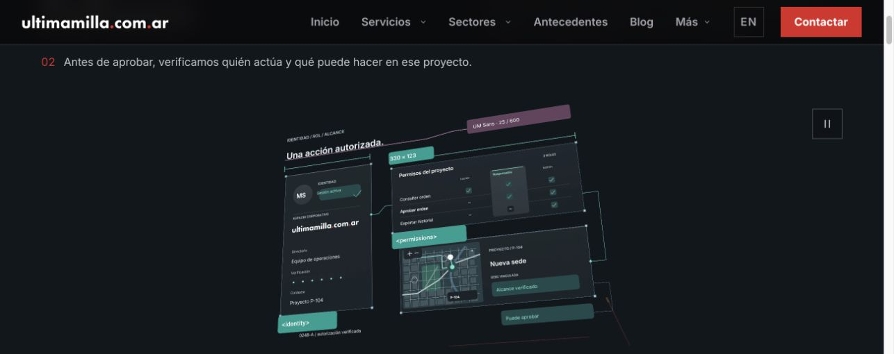
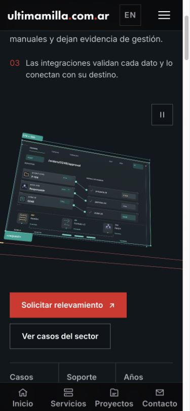
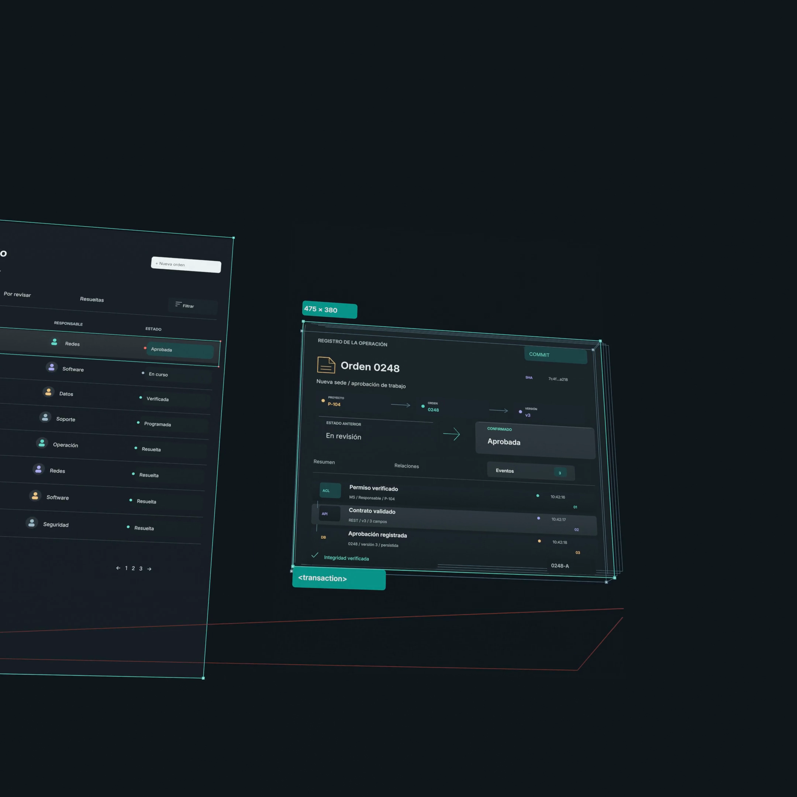

# Software v24 · película completa y revisión integrada

## Qué cuenta

Una orden conserva su identidad al pasar por la interfaz, los permisos, el contrato de integración y el registro. El resultado vuelve al equipo que inició la operación. La pieza muestra un sistema ilustrativo de software a medida, no la arquitectura real de un cliente.

Se aplicó la skill `uml-and-software-architecture-visualization`: identificadores persistentes, relaciones de procedencia y canales reservados para las conexiones. La película usa una vista UML-like de interacción; el diagrama formal no sustituye la experiencia cinematográfica. Los capítulos de texto y la explicación de capas debajo del banner transmiten el contenido esencial sin exigir leer los microdetalles.

## Correcciones visuales

- Matriz de roles y acciones, con la columna efectiva elevada y permisos diferenciados.
- Contrato con navegación, campos tipados, puertos y correspondencias entre solicitud y modelo de dominio.
- Registro con Proyecto → Orden → Versión, procedencia ACL/API/DB e historial temporal.
- Logo vectorial de Última Milla, imagen de proyecto y mapa; los módulos comparten la misma orden, proyecto y versión.
- Transparencias selectivas y niveles de profundidad que conservan la figura principal.
- El cierre mantiene visible el registro hasta la vuelta de la interfaz. Se corrigió el vacío observado alrededor de 17,1 s y se adelantó el final del fundido para retirar el texto residual detrás del producto.
- Capítulos sincronizados por encima de la película, con altura reservada. El cuadro completo se adapta al alto disponible en escritorio; el móvil recibe una composición cuadrada propia.

## Render y procedencia

La geometría y los primeros 960 fotogramas de cada composición son exactamente los de v23, fuente `feb08d50fc135ae7eee829e575a137882d713490`, render completo [38146133734](https://github.com/martinsantos/um25/actions/runs/38146133734). El SHA-256 de esa fuente se verifica antes de reutilizarla.

V24 cambia únicamente el relevo del cierre. Su fuente es `808eef21a369b1ed1efaeb68ec2ac1ba63160251`. La prueba corregida [38150249394](https://github.com/martinsantos/um25/actions/runs/38150249394) terminó correctamente en 4K horizontal y 2160 cuadrado. Los 16 segmentos finales se calcularon correctamente en [38150616687](https://github.com/martinsantos/um25/actions/runs/38150616687).

El ensamblado conserva la procedencia real de los 64 fragmentos reutilizados y exige la fuente v24 y su base para los 16 nuevos. No vuelve a comprimir los segmentos. El manifiesto registra cada rango y ejecución; los fotogramas antiguos no se presentan como recién renderizados.

## Validación

- Auditoría proyectada en 1.200 posiciones por composición: 190 combinaciones de texto/composición dentro del cuadro, sin intersecciones de límites de texto.
- 79 pruebas en tres suites: reproducción, pausa, reducción de movimiento, comportamiento fuera de pantalla y aislamiento de la bandera de preview.
- Typecheck correcto; lint sin errores y con 10 advertencias preexistentes.
- Dos películas completas, decodificadas sin errores: 3840 × 2160 y 2160 × 2160, 20 s, 60 fps, 1.200 fotogramas cada una. Seis activos inmutables: 62.051.962 bytes.
- Build con v24 correcto. `/software` y el servicio 104 responden 200 y seleccionan v24; ambos MP4 responden 206 a peticiones Range.
- Chrome a 1301 × 516 y móvil emulado 390 × 844: autoplay, vuelta al inicio, pausa/reanudación y suspensión fuera de pantalla comprobados. La película móvil usa su fuente cuadrada y no produce desborde horizontal.
- Capítulos de altura estable: 48 px en escritorio, 72 px en móvil. El cuadro completo de escritorio cabe entre y=138,7 e y=504,7 debajo de la cabecera en la posición de lectura revisada.
- El fotograma móvil de 17,15 s conserva el registro durante el relevo. La prueba final de 17,67 s retira el texto saliente antes de la interfaz; no quedó el texto residual observado en la primera prueba.
- No se midieron fotogramas perdidos en hardware móvil físico; las capturas y estados temporales no certifican por sí solos la percepción de los 1.200 fotogramas.

## Comparación con Hill

Se usa el vídeo original de [David Hill](https://x.com/iamdavidhill/status/2107616166713655476), no una reconstrucción de su estilo. Se contrastan los instantes con contenido, la transición entre planos y el funcionamiento integrado.

La candidata incorpora tipografía, medidas animadas, identidad visual y controles con contenido. La referencia conserva mayor variedad de marcas y microcomponentes simultáneos. La candidata tiene una operación técnica propia y una cadena de datos que se puede seguir. Los checks geométricos y de reproducción no certifican equivalencia artística; no se asigna un porcentaje ni se declara calidad indistinguible.

## Publicación

Sólo preview local mediante `UM_SOFTWARE_REVIEW=v24`. Se conserva el registro de medios de producción. PR #266 sigue como borrador hacia `develop`; no se realizó merge ni despliegue.

## Evidencia

[Entrega y procedencia](evidence/software-v24/delivery.json) · [Contrato frente a Hill](evidence/software-v24/hill-contract.png) · [Registro frente a Hill](evidence/software-v24/hill-record.png).

