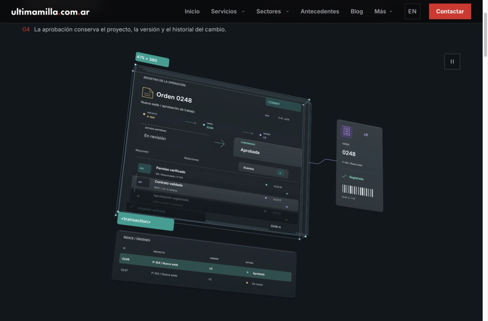
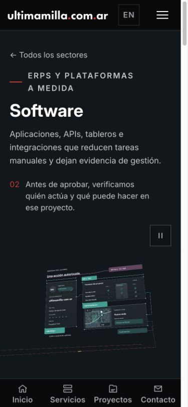

# Software v25 · composición y película completa

## Objetivo

Conservar una operación reconocible —orden 0248, proyecto P-104— mientras se ven la interfaz, identidad y permisos, contrato de integración, persistencia y retorno al equipo. Comparar con el original de David Hill: variedad de controles, profundidad por planos, líneas jerarquizadas, transparencia selectiva y continuidad temporal.

## Cambios

- Directorio de equipo en un plano independiente bajo los permisos, con roles, avatares y estado.
- Seis conectores con símbolos propios: ERP, CRM, API, datos, eventos y cloud. Cada uno tiene forma, color, descripción y estado de conexión.
- Respuesta tipada 202 con la misma identidad 0248-A, separada del contrato.
- Índice de órdenes y comprobante con versión y procedencia, físicamente separados del registro.
- Encuadre ampliado sólo en los planos que incorporan contexto; trayectoria de cámara continua y eje cruzado conservados.
- Entradas y salidas escalonadas, coordinando tipografía, contornos y superficies.
- La ruta entre mecanismos se muestra durante el tránsito; se retira durante la lectura para no atravesar títulos.

El ejemplo es ilustrativo. Los símbolos de conectores son originales; no se afirman integraciones de clientes, topologías reales ni métricas de rendimiento.

## Películas entregadas

Las dos composiciones completas están integradas en `/software` y en el servicio 104 mediante `UM_SOFTWARE_REVIEW=v25`:

| Composición | Resolución | Duración y frecuencia | MP4 |
| --- | --- | --- | --- |
| Escritorio | 3840 × 2160 | 20 s · 60 fps · 1.200 fotogramas | 35.801.818 bytes |
| Móvil | 2160 × 2160 | 20 s · 60 fps · 1.200 fotogramas | 19.698.671 bytes |

H.264, yuv420p, BT.709 con transferencia sRGB, rango TV y cabecera faststart. Los seis archivos de reproducción y poster suman 56.514.866 bytes. El móvil selecciona la composición cuadrada y el poster AVIF de 93.622 bytes. No se redujo la resolución del render.

La entrega final ensambla 74 segmentos originales y seis reparados, todos nativos. Los hashes y la procedencia de cada segmento de 30 fotogramas están en [delivery.json](evidence/software-v25/delivery.json); la información detallada y los intermedios permanecen en SDTERA.

## Fuente y reparaciones

- Render completo: [38155111568](https://github.com/martinsantos/um25/actions/runs/38155111568), fuente `24cd19f2e1f906bce3e6cc1dc8c390bf71059eed`. Ochenta segmentos completos.
- La ruta reaparecía durante la actualización de fotograma: corregida con un manejador persistente `frame_change_post`, validado antes del render completo en [38154880234](https://github.com/martinsantos/um25/actions/runs/38154880234).
- Cruces con tres rótulos en 702–706: reparación [38156513139](https://github.com/martinsantos/um25/actions/runs/38156513139), fuente `729e2ae56c22b973c0db44244bf0afeb9c30e3a5`, sólo 690–719 y 720–749 por composición.
- Cruce con el título del índice aún visible durante su salida en 844–851: reparación [38156933447](https://github.com/martinsantos/um25/actions/runs/38156933447), fuente `9e42d14b31e805fdbeafef09a718a2eb0881d2af`, sólo 840–869 por composición.

La primera secuencia obsoleta se canceló. Sus resultados no se importaron. `assemble-software-v25-final.py` exige las fuentes correctas para los seis reemplazos, cuenta los 1.200 fotogramas sin huecos ni duplicados y decodifica ambas películas completas antes de importar.

## Revisión integrada y correcciones

Chrome en macOS, vista habitual 1301 × 516, escritorio 1366 × 900 y viewport móvil 390 × 844. Se comprobó el vídeo real, no sólo el poster: 3840 × 2160 en escritorio y 2160 × 2160 en móvil. Las leyendas cambian con el tiempo reproducido; se observaron permisos, integración, registro, retorno al equipo y reinicio del ciclo. Pausa y reanudación manual funcionan; salir de pantalla detiene el vídeo conservando su posición. No se observó desbordamiento horizontal.

El reproductor nuevo, `cine-banner-v12.js`, conserva el comienzo cuando el vídeo apenas asoma bajo el pliegue. Arranca solo al superar el 60 % visible. Esto evita consumir la apertura mientras la persona todavía lee la cabecera. El botón refleja la intención de reproducción automática, incluso mientras espera visibilidad: no aparenta exigir un clic para arrancar. Una prueba de regresión cubre entrada parcial, pausa antes del inicio, reproducción automática y continuidad al volver. Sólo la preview v25 selecciona este reproductor; no se modifica ningún archivo público ya publicado.

Las dos rutas devuelven HTTP 200; las dos películas responden HTTP 206 a una petición Range. Build y typecheck pasan. Las suites de reproducción e integración pasan 74 pruebas tras la corrección; la suite específica de Software había pasado otras siete. Lint: cero errores y diez advertencias preexistentes.

El control se hizo en Chrome de escritorio con viewport móvil: no equivale a una medición de fluidez en un iPhone/Android físico ni certifica 60 fotogramas presentados por segundo. La decodificación completa verifica el archivo; las capturas y observaciones temporales verifican instantes y transiciones de la experiencia, no constituyen una certificación subjetiva de cada fotograma.

## Comparación con Hill

Referencia: [David Hill](https://x.com/iamdavidhill/status/2107616166713655476). Se reprodujeron las dos películas en paralelo y se compararon mecanismos equivalentes, usando la zona de contenido de la referencia y evitando su placa final negra.

[Contrato frente a Hill](evidence/software-v25/hill-contract.png) · [Registro frente a Hill](evidence/software-v25/hill-record.png)

La v25 añade identidad visual, mapa, imagen de proyecto, directorio, símbolos diferenciados, respuesta tipada y comprobante. Los planos secundarios tienen contenido y profundidad propios. Las conexiones de la operación permanecen legibles durante la lectura, y el mismo identificador une las etapas. Los relevos son continuos y se reproducen sin seleccionar capas.

La comparación todavía no permite afirmar calidad indistinguible. Hill aprovecha más el encuadre con componentes secundarios de distintas siluetas y mayor densidad de controles. La v25 conserva más espacio libre alrededor de los mecanismos; en 390 px los rótulos internos más pequeños aportan textura, pero no son texto de lectura. La explicación exterior sí permanece legible. No se oculta esa diferencia con un porcentaje ni se declara aprobada para producción.

## Protección y continuidad

Selección sólo con `UM_SOFTWARE_REVIEW=v25`; el registro de medios de producción permanece intacto. No hubo merge ni despliegue. Blender se ejecutó sólo en GitHub Actions. El ensamblado y la decodificación local usaron dos hilos; los intermedios se guardaron en `/Volumes/SDTERA/Codex UM25 audits/20261011/software-v25/`. No se crearon worktrees ni se tocaron campaña, isometrías o fuentes.
